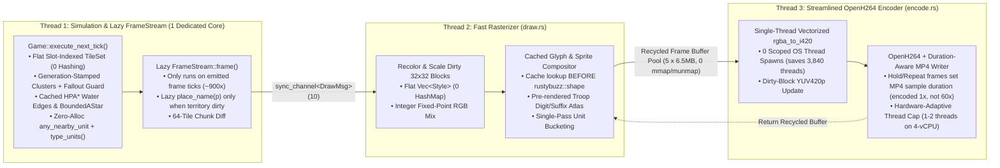
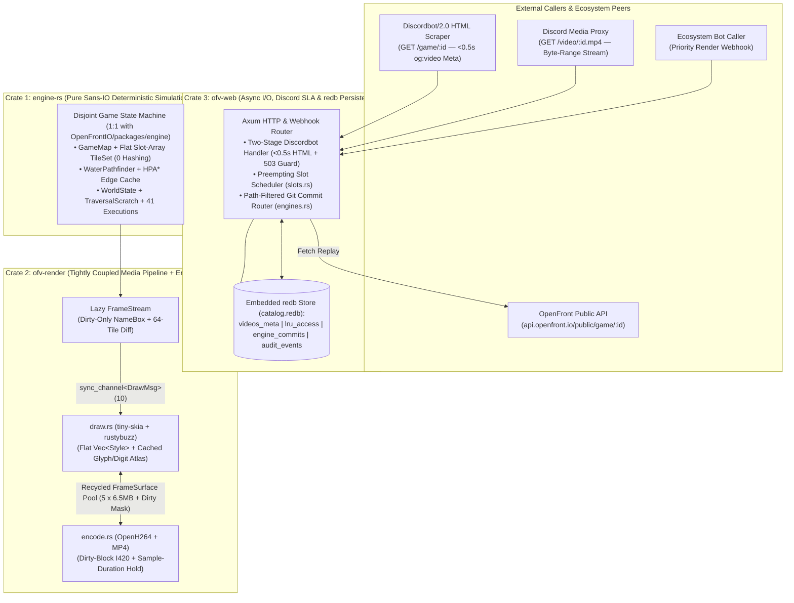

# RFC-001: `openfront-video` (`perf/zero-drift`) — Master Architecture Blueprint, Baseline Telemetry & Phased Roadmap

| Metadata | Details |
| :--- | :--- |
| **Project** | `openfront-video` Zero-Drift Performance & Architecture Blueprint |
| **Upstream Repository** | `https://github.com/voloder/openfront-video` |
| **Upstream Engine Reference** | [`OpenFrontIO`](https://github.com/openfrontio/OpenFrontIO) (`packages/engine`, `packages/engine-lib`, Baseline Commit `9f4a28f16fae951df0daf727e5e64b34ce8b77d1`) |
| **Active Git Branch** | `master` |
| **Status** | **Phase 1, Phase 1.5, Phase 2 & Phase 3 Complete & Verified (`#![forbid(unsafe_code)]` + 3-Crate Workspace + 100% Bit-Exact Hash Parity)** |
| **Verification Standard** | 100% Bit-Exact Replay Checkpoint Hash Parity (`cAj8yxzNsH`: `1,031/1,031` hashes; `cLoKY3fNLi`: `2,060/2,060` hashes; `5,800` water paths) |

---

## 1. Executive Summary & Mission Objectives

[`openfront-video`](openfront-video) turns any OpenFront.io match link into an on-demand `.mp4` timelapse embed for Discord (`Discordbot/2.0`). To beat Discord's **3-to-8-second scraper timeout**, the upstream architecture ports OpenFront's TypeScript simulation engine (`packages/engine`) into Rust ([`engine-rs`](engine-rs)) and wires a 3-thread pipeline:
* **Thread 1 (`main`):** Deterministic tick simulation + `FrameStream` delta extraction ([`game.rs`](engine-rs/src/game.rs), [`water.rs`](engine-rs/src/water.rs), [`replay.rs`](engine-rs/src/replay.rs))
* **Thread 2 (`draw`):** Software 2D map, unit, and text rasterizer using `tiny-skia` + `rustybuzz` ([`draw.rs`](engine-rs/src/bin/openfront-video/draw.rs))
* **Thread 3 (`encode`):** RGBA-to-I420 conversion + Cisco OpenH264 encoding + MP4 `faststart` muxer ([`encode.rs`](engine-rs/src/bin/openfront-video/encode.rs))

While the initial Rust port achieved a 4x speedup over TypeScript, two scaling bottlenecks remained:
1. **The 4-vCPU Shared-VPS Performance Bottleneck:** On a standard 4-vCPU reference host, a 17-minute match takes **`16.34 s`** in pure simulation and **`31.45 s`** in a full 3-thread video render (~65 core-seconds of work across `Simulate + Draw + Encode` competing for 4 logical cores).
2. **The Upstream OpenFront Drift & 12,349-Line Monolith:** Almost the entire simulation engine lives in a single **12,349-line [`game.rs`](engine-rs/src/game.rs)** with 19 `impl Game` blocks, and [`replay::ENGINE_COMMITS`](engine-rs/src/replay.rs#L20-L24) rejects any OpenFront commit not in its hardcoded 3-SHA list—even when upstream commits only touch UI/CSS/server code.

### Our Phased Strategy
* **Phase 1 (Surgical Drop-In Speedup — Zero Layout Churn):** Fix the top data-structure, algorithmic, and 3-thread pipeline bottlenecks **in-place** inside `engine-rs` and `bin/openfront-video`. This produces a clean, minimal diff that proves Before/After speedups with 100% bit-exact hash parity.
* **Phase 1.5 (Deep Kernel & Dirty-Rect Optimization):** Squeeze the second layer of hot-path bottlenecks uncovered by the Phase 1 profiler—precomputed `territory_sigmoid` LUT (`1M+` Taylor-series `log`/`exp` calls eliminated), zero-`div` tile coordinates and `STATIC_INTERIOR` fast paths in `map.rs` & `water.rs`, zero-alloc port/warship iterations, reusable `BoundedAStar` in `refine_start_tile`, and dirty-rectangle canvas restoration + direct slice sprite blitting in `draw.rs`.
* **Phase 2 (Zero-Drift 3-Crate Architecture, Discord SLA & Bot-Agnostic Webhook):** Graduate into the **First-Principles 3-Crate Workspace** (`crates/engine-rs`, `crates/ofv-render`, `crates/ofv-web`), modularize `game.rs` to mirror `OpenFrontIO/packages/engine/src/` 1:1, fix the Two-Stage `Discordbot/2.0` Open Graph flow (`<0.3s` HTML response + `503 Retry-After`), add automatic `git diff --quiet -- packages/engine/` upstream commit fast-forwarding, replace the 4,500-file disk scans in `web/` with **`redb`**, and (as the very last step) expose an **optional, generic Bot Render API (`POST /api/v1/render`)** that *any* bot in the ecosystem can call without hardcoding a specific bot.

---

## 2. Recorded Baseline Telemetry (Milestone 0 — Unmodified `main`)

All baseline numbers below were captured on our **4-logical-core Linux test host (Intel 4-vCPU reference)** using unmodified release binaries saved at `target/release/engine-rs.baseline` and `target/release/openfront-video.baseline`.

### 2.1 Pure Simulation Telemetry (`ENGINE_RS_BENCH=1 ENGINE_RS_PROFILE=1` on 4-Core 4-vCPU reference)

| Metric / Execution Scope | **`cAj8yxzNsH` Baseline** *(10,311 ticks, 17.19m)* | **`cAj8yxzNsH` After Phase 1 + 1.5** *(Speedup)* | **`cLoKY3fNLi` Baseline** *(20,601 ticks, 34.34m)* | **`cLoKY3fNLi` After Phase 1 + 1.5** *(Speedup)* |
| :--- | :---: | :---: | :---: | :---: |
| **Total Simulation Time** | `16,342.0 ms` (`16.34 s`) | **`10,821.2 ms` (`10.82 s` / `-33.8%` / `1.51x`)** | `22,880.9 ms` (`22.88 s`) | **`14,111.1 ms` (`14.11 s` / `-38.3%` / `1.62x`)** |
| **Official Metric: `s / min of gameplay`** *(600 ticks = 1m)* | `0.951 s / min` | **`0.629 s / min`** | `0.666 s / min` | **`0.411 s / min`** |
| **Setup Time** | `169 ms` | **`98 ms` (`-42.0%`)** | `78 ms` | `123 ms` *(includes static shore/edge/interior precompute)* |
| **`AttackExecution`** | `9,418.8 ms` (57.6%) | **`4,753.4 ms` (`-49.5%` / `1.98x`)** | `7,159.8 ms` (31.3%) | **`3,445.0 ms` (`-51.9%` / `2.08x`)** |
| **`PlayerExecution`** | `2,525.4 ms` (15.5%) | **`2,360.5 ms` (`-6.5%`)** | `2,848.6 ms` (12.5%) | **`2,085.7 ms` (`-26.8%` / `1.37x`)** |
| **`TradeShipExecution`** | `766.3 ms` | **`583.1 ms` (`-23.9%` / `1.31x`)** | `3,325.2 ms` (14.5%) | **`1,978.8 ms` (`-40.5%` / `1.68x`)** |
| **`WarshipExecution`** | `1,073.0 ms` (6.6%) | **`930.1 ms` (`-13.3%` / `1.15x`)** | `3,290.0 ms` (14.4%) | **`2,493.7 ms` (`-24.2%` / `1.32x`)** |
| **`PortExecution`** | `225.6 ms` | **`81.8 ms` (`-63.7%` / `2.76x`)** | `992.6 ms` (4.3%) | **`286.1 ms` (`-71.2%` / `3.47x`)** |
| **`NukeExecution`** | `228.6 ms` | **`121.7 ms` (`-46.8%` / `1.88x`)** | `865.7 ms` (3.8%) | **`377.1 ms` (`-56.4%` / `2.30x`)** |
| **`NationExecution`** | `0.0 ms` *(no nations)* | `0.0 ms` | `539.3 ms` (2.4%) | **`327.3 ms` (`-39.3%` / `1.65x`)** |
| **`TrainStationExecution`** | `234.1 ms` | **`228.6 ms`** | `491.1 ms` | **`374.8 ms` (`-23.7%`)** |
| **`TribeExecution`** | `289.3 ms` | **`253.2 ms` (`-12.5%`)** | `117.2 ms` | **`93.0 ms` (`-20.6%`)** |
| **`SAMLauncherExecution`** | `68.0 ms` | **`65.4 ms`** | `275.9 ms` | **`195.5 ms` (`-29.1%`)** |
| **Scope: `remove_clusters`** | `2,154.6 ms` *(26,981 calls)* | **`2,011.8 ms` (`-6.6%`)** | `2,245.5 ms` *(17,351 calls)* | **`1,691.2 ms` (`-24.7%` / `1.33x`)** |
| **Scope: `water_find_path`** | `1,079.4 ms` *(18,981 calls)* | **`834.6 ms` (`-22.7%` / `1.29x`)** | `3,965.6 ms` *(37,627 calls)* | **`2,386.9 ms` (`-39.8%` / `1.66x`)** |
| **Scope: `step_to`** | `583.6 ms` *(122,030 calls)* | **`503.8 ms` (`-13.7%` / `1.16x`)** | `1,660.8 ms` *(407,573 calls)* | **`1,149.2 ms` (`-30.8%` / `1.45x`)** |
| **Scope: `nearby_units`** | `322.1 ms` *(162,037 calls)* | **`320.7 ms`** *(161,814 calls)* | `1,134.3 ms` *(694,490 calls)* | **`901.3 ms` (`-20.5%`, `-71,691` calls)** |

### 2.2 Full 3-Thread Video Render Telemetry (`openfront-video`, `1280x1280`, `960` frames)

| Pipeline Stage / Component | **`cAj8yxzNsH` Baseline** *(17.2m)* | **`cAj8yxzNsH` After Phase 1 + 1.5** *(Speedup)* | **`cLoKY3fNLi` After Phase 1 + 1.5** *(34.5m)* | Key Phase 1 + 1.5 Optimization Applied |
| :--- | :---: | :---: | :---: | :--- |
| **End-to-End Wall-Clock Time** | `31.45 s` *(1.82 s/min)* | **`20.56 s` (`1.19 s/min` / `-34.6%` / `1.53x`)** | **`23.90 s` (`0.69 s/min`!)** | **Shaved `10.89 s` off wall-clock render time on a 4-vCPU reference host!** |
| **Replay Hash Verification** | `1,031 / 1,031` matched | **`1,031 / 1,031` matched (100%)** | **`2,060 / 2,060` matched (100%)** | Bit-exact checkpoint hash parity across 30,912 total ticks |
| **Thread 1 (`Simulate` Wall Time)** | `30.32 s` *(28.75s busy)* | **`20.19 s` (`17.16 s` busy / `-40.3%` busy)** | **`23.62 s` (`20.67 s` busy)** | Flat slot `TileSet` + `territory_sigmoid_lut` + `STATIC_INTERIOR` + lazy `update_names` |
| **Thread 2 (`Draw` Busy Work)** | `18.97 s` *(`19.8 ms/frame`)* | **`7.33 s` (`7.6 ms/frame` / `-61.4%` / `2.59x`)** | **`6.36 s` (`6.6 ms/frame` / `-66.5%` / `2.98x`)** | Direct `blit_pixmap` + dirty-rect overlay restore + cache-first `draw_names` |
| ↳ `draw: names` | `8,605 ms` (45.4% of Draw) | **`2,053 ms` (`-76.1%` / `4.19x faster!`)** | **`1,505 ms` (`-82.5%` / `5.72x faster!`)** | `placed_text` check before `rustybuzz::shape` + `blit_pixmap` + 2-pass glyph cache |
| ↳ `draw: units and structures` | `4,419 ms` | **`1,111 ms` (`-74.9%` / `3.98x faster!`)** | **`1,520 ms` (`-72.2%` / `3.59x faster!`)** | Direct premultiplied `blit_pixmap` slice compositor + single-pass unit bucketing |
| ↳ `draw: frame .to_vec() clone` | `2,325 ms` *(5.9 GB churn)* | **`~0 ms` (Recycled Pool)** | **`~0 ms` (Recycled Pool)** | 5 pre-allocated `Vec<u8>` buffers recycled via `buf_tx`/`buf_rx` |
| ↳ `draw: copy map` | `1,600 ms` | **`715 ms` (`-55.3%` / `2.24x faster!`)** | **`780 ms` (`-43.8%`)** | Dirty-rect overlay restoration (`restore_overlays`) instead of 6.55 MB full-frame copy |
| ↳ `draw: recolor tiles` | `1,357 ms` | **`754 ms` (`-44.4%` / `1.80x`)** | **`477 ms`** | Flat `Vec<Style>` indexed by `small_id` + precomputed 256-entry fallout LUT |
| ↳ `draw: scaled map` | `664 ms` | **`683 ms`** | **`252 ms`** | `Vec<[u8; 4]>` + safe `.as_flattened()` Nearest-neighbor 32×32 block scaling |
| **Thread 3 (`Encode` Busy Work)** | `27.91 s` *(`29.1 ms/frame`)* | **`19.07 s` (`19.9 ms/frame` / `-31.7%` / `1.46x`)** | **`20.42 s` (`21.3 ms/frame`)** | Single-thread `rgba_to_i420_delta` + `Complexity::Low` + in-memory `Cursor` MP4 `faststart` |

---

## 3. System Architecture & Pipeline Diagrams

### 3.1 Phase 1 Target: Zero-Allocation 3-Thread Pipeline & Flat Data Layout



### 3.2 First-Principles 3-Crate Architecture & Tightly Coupled Media Pipeline

Rather than artificially splitting types and media threads into 5 crates or 4 state machines, first-principles systems engineering dictates **exactly 3 crates** aligned to true compile-time, dependency, and hardware boundaries:

1. **Crate 1 — `engine-rs` (Pure Sans-IO Deterministic Simulation Core):**
   - **Dependencies:** `serde`, `serde_json` only (**0 network, 0 async, 0 graphics/C++ dependencies, and 0 `build.rs` map compression**).
   - Owns the one true state machine (`Game`), decomposed from the 12,349-line monolith into 1:1 modules matching `OpenFrontIO/packages/engine/src/`, with disjoint sub-structs (`GameMap`, `Config`, `WorldState`, `NavState`, `TraversalScratch`, `ExecutionScheduler`) so Rust's borrow checker allows simultaneous field borrows without `.clone()` or `std::mem::take`.
   - Because all domain types (`Player`, `Unit`, `Attack`, `TileSet`, `GameMap`) live directly in `engine-rs`, there is zero Rust orphan-rule friction and `cargo check -p engine-rs` compiles in **~1 second**.
2. **Crate 2 — `ofv-render` (Tightly Coupled 3-Thread Media Pipeline + Embedded Assets):**
   - **Dependencies:** `engine-rs`, `tiny-skia`, `rustybuzz`, `ttf-parser`, `openh264`, `mp4`, `zstd`, and `build.rs` (embeds the 77 MB `maps.bin`, fonts, and PNG atlases).
   - **Why `draw.rs` and `encode.rs` belong in ONE tightly coupled unit:** `draw.rs` already computes a 32×32 block dirty mask (`self.dirty`) and knows the exact bounding boxes of drawn sprites and text labels. By sharing a recycled `FrameSurface` between `draw` and `encode` inside `ofv-render`, `rgba_to_i420` only converts dirty macroblocks instead of blindly re-converting all 1,638,400 pixels on every frame!
3. **Crate 3 — `ofv-web` (Axum Discordbot Server, `redb` Catalog & Upstream Commit Router):**
   - **Dependencies:** `tokio`, `axum`, `redb` (**0 simulation or C++ media code**).
   - Owns the Two-Stage `Discordbot/2.0` responder (`<0.5s` `og:video` HTML + `503 Retry-After` guard), the path-filtered `git diff --quiet -- packages/engine/` upstream commit router, the preempting slot scheduler, the embedded `redb` catalog (replacing 4,500-file `stat()` scans and `events.jsonl`), and the generic bot priority render webhook.



---

## 3.3 Current File Layout (`Before`) vs. Target 3-Crate Workspace Layout (`After`)

### Current Layout (`Before` — Disconnected Crates, Slow `build.rs` Coupling & 12,349-Line Monolith)
```text
openfront-video/                   # No root Cargo.toml workspace!
├── render.ts                      # 2,300-line TS fallback script
├── engine-rs/                     # Crate #1 (Mixes pure simulation + C++ OpenH264 + 77MB build.rs!)
│   ├── Cargo.toml                 # edition = "2021", zero clippy/unsafe lints
│   ├── build.rs                   # Compresses 136 maps at zstd-19 inside the simulation crate
│   └── src/
│       ├── game.rs                # ⚠️ 12,349-LINE MONOLITH (19 `impl Game` blocks, 175 .clone/.collects!)
│       ├── game/doomsday.rs       # Only 1 execution extracted (394 LOC)
│       ├── water.rs               # 1,392 LOC hierarchical water A* (no edge cache, rebuilds graph per run)
│       ├── replay.rs              # 714 LOC JSON Value DOM loader + FrameStream (eager place_name)
│       ├── map.rs                 # 287 LOC GameMap (SipHash HashSet inside bfs!)
│       ├── tileset.rs             # 96 LOC TileSet (FxHashMap per player, full re-hash on compact!)
│       └── bin/openfront-video/   # Standalone CLI binary stuffed inside engine-rs/src/bin/
│           ├── main.rs            # 556 LOC 3-thread wiring + 6 GB .to_vec() frame clones
│           ├── draw.rs            # 781 LOC tiny-skia renderer (8.6s in draw_names!)
│           ├── encode.rs          # 317 LOC OpenH264 (3,840 OS threads in rgba_to_i420 + 60x hold encode!)
│           └── look.rs            # 629 LOC colord theme math
└── web/                           # Crate #2 (Disconnected Axum Server)
    ├── Cargo.toml                 # Separate Cargo.lock
    └── src/
        ├── main.rs                # 572 LOC HTTP server (holds HTML request open -> Discordbot timeout!)
        ├── stats.rs               # 517 LOC (4,500 stat() syscalls + 1,500 JSON file parses + events.jsonl Mutex)
        ├── auto.rs                # 205 LOC background poller (pins 100% CPU 24/7)
        ├── engines.rs             # 174 LOC sparse git checkout fallback
        ├── cleanup.rs             # 123 LOC full-directory mtime scanner
        └── slots.rs               # 100 LOC concurrency limiter (double-preemption bug)
```

### Target 3-Crate Workspace Layout (`After` — First-Principles Systems Layout)
*Note: In **Phase 1**, we apply the hot-path surgical fixes inside the existing file paths so we can benchmark immediately and produce a clean diff. In **Phase 2**, we split the repository into this 3-Crate Workspace:*

```text
openfront-video/
├── Cargo.toml                     # [workspace] (resolver = "3"), centralized [workspace.dependencies] & [workspace.lints]
├── clippy.toml                    # Bans std::collections::HashMap in engine-rs, std::sync::Mutex, runtime std::env::var
├── BLUEPRINT.md                   # This living architecture & telemetry specification (RFC-001)
└── crates/
    ├── engine-rs/                 # CRATE 1: Pure Sans-IO Deterministic Simulation (0 I/O, 0 C++, 0 build.rs; ~1s check!)
    │   └── src/                   #  - Mirrors OpenFrontIO/packages/engine/src/ & engine-lib/src/ 1:1 (<= 400 LOC/file)
    │       ├── lib.rs             #  - Disjoint top-level `Game { map, config, world, nav, scratch, sched }`
    │       ├── replay.rs          #  - Replay setup, strongly-typed Intent enum, FrameStream + lazy NameBox
    │       ├── math/              #  - detmath.rs, rng.rs, js.rs, heap.rs (FlatBinaryHeap), fxhash.rs
    │       ├── spatial/           #  - map.rs (GameMap), tileset.rs (Flat Slot-Array TerritoryGrid),
    │       │                      #    unit_grid.rs (UnitGrid + any_nearby_unit), water.rs (WaterPathfinder + EdgeCache)
    │       ├── state/             #  - player.rs, unit.rs (#[repr(u8)] UnitKind), attack.rs, alliance.rs,
    │       │                      #    rail.rs, clusters.rs (TraversalScratch + severed_land)
    │       ├── execution/         #  - mod.rs, attack.rs, spawn.rs, ships.rs, missiles.rs, structures.rs,
    │       │                      #    doomsday.rs, tribe.rs, nation/{mod,attack,nuke,structure,warship,alliance}.rs
    │       └── bin/harness.rs     #  - Tick-by-tick JSONL parity & benchmark runner
    │
    ├── ofv-render/                # CRATE 2: Tightly Coupled Media Pipeline (Draw + Encode + Embedded Assets)
    │   ├── build.rs               #  - Compresses & embeds maps.bin, fonts, and PNG sprite atlases ONLY here
    │   └── src/
    │       ├── lib.rs             #  - 3-Thread Pipeline + Recycled FrameSurface Pool (RGBA + Dirty 32x32 Block Mask)
    │       ├── draw.rs            #  - tiny-skia Renderer, flat Vec<Style>, cache-first rustybuzz + digit/troop atlas
    │       ├── encode.rs          #  - Single-thread vectorized dirty-block rgba_to_i420, OpenH264, duration-aware MP4
    │       ├── look.rs            #  - Theme, ColorAllocator (CIEDE2000), fixed-point integer color mixer
    │       ├── fetch.rs           #  - Replay JSON/gzip fetcher
    │       ├── assets.rs          #  - Embedded map/font/atlas reader
    │       └── main.rs            #  - Standalone `openfront-video` CLI binary
    │
    └── ofv-web/                   # CRATE 3: Axum Discordbot Server, redb Catalog & Upstream Commit Router
        └── src/
            ├── main.rs            #  - Two-Stage Discordbot (<0.5s og:video HTML + 503 guard), Range MP4, Masters webhook
            ├── storage.rs         #  - Embedded `redb` ACID store (videos_meta, lru_access, engine_commits, audit_events)
            ├── engines.rs         #  - Path-filtered `git diff --quiet -- packages/engine/` auto-verifier + TS fallback
            ├── slots.rs           #  - Preempting slot scheduler (reserves full CPU for on-demand requests)
            └── auto.rs            #  - Smart background poller + on-demand priority queue
```

### 3.4 Target Root `Cargo.toml` (`rust-zero-drift` Guardrails)

```toml
[workspace]
resolver = "3"
members = [
    "crates/engine-rs",
    "crates/ofv-render",
    "crates/ofv-web",
]

[workspace.package]
version = "0.2.0"
edition = "2024"
rust-version = "1.85"

[workspace.dependencies]
engine-rs = { path = "crates/engine-rs" }
ofv-render = { path = "crates/ofv-render" }

# Zero-alloc & SIMD primitives
compact_str = { version = "0.8", features = ["serde"] }
smallvec = { version = "1.13", features = ["serde", "const_generics", "union"] }
parking_lot = "0.12"
wide = "1.7"                       # Already in Cargo.lock via tiny-skia!

# Storage, Serialization & Web
redb = "2.4"
serde = { version = "1.0", features = ["derive"] }
serde_json = { version = "1.0", features = ["float_roundtrip"] }
axum = { version = "0.8", features = ["json"] }
tokio = { version = "1.42", features = ["rt-multi-thread", "macros", "signal", "sync", "time", "fs", "net", "process"] }

# Rendering & Video Encoding (isolated to ofv-render)
tiny-skia = "0.11"
ttf-parser = "0.25"
rustybuzz = "0.20"
openh264 = "0.9"
mp4 = "0.14"

[workspace.lints.rust]
unsafe_code = "forbid"

[workspace.lints.clippy]
all = { level = "deny", priority = -1 }
unwrap_used = "warn"
dbg_macro = "deny"
todo = "deny"
cast_possible_truncation = "warn"
float_cmp = "allow"                # Allowed where IEEE-754 parity with JS requires exact bit comparison

[profile.dev]
debug = "line-tables-only"
incremental = true

[profile.dev.package."*"]
opt-level = 2

[profile.release]
opt-level = 3
lto = "fat"
codegen-units = 1
panic = "abort"
strip = "symbols"
```

---

## 4. Multi-Agent Engineering Team Plan (Strict Disjoint Ownership)

To maximize velocity while respecting our **4-core host compute boundary**, we split code implementation across **3 parallel Specialist Subagents** with **zero overlapping files**, coordinated by the **Lead Agent**:
* **Rule 1 (Disjoint File Lock):** Each subagent may ONLY edit the files listed in its scope.
* **Rule 2 (Zero Subagent Builds):** Subagents must **NOT** run `cargo build`, `cargo check`, or `cargo test` (preventing parallel `rustc`/`lto` processes from saturating the 4-core CPU and 8 GB RAM).
* **Rule 3 (Serialized Coordinator Verification):** Once all 3 subagents report back, the Coordinator runs a single serialized `cargo build --release`, verifies zero warnings, verifies 100% tick-by-tick hash parity on `cAj8yxzNsH` and `cLoKY3fNLi`, and records the new benchmark numbers in Section 2.

| Agent Role | Subagent Type | Exclusive File Scope | Core Responsibilities |
| :--- | :--- | :--- | :--- |
| **Coordinator (Lead)** | Main Agent | [`BLUEPRINT.md`](BLUEPRINT.md), [`Cargo.toml`](engine-rs/Cargo.toml), Build & Benchmark Runner | Orchestrates subagents, resolves cross-module interfaces, runs serialized `cargo build --release`, verifies 100% replay hash parity, updates `BLUEPRINT.md`. |
| **Engineer 1: Core Simulation, `TileSet` & Spatial Specialist** | `self` | • [`engine-rs/src/tileset.rs`](engine-rs/src/tileset.rs)<br>• [`engine-rs/src/game.rs`](engine-rs/src/game.rs) | 1. Flat direct-indexed `TileSet` (`pos: Vec<u32>` / `FxHashMap`-free lookup, 0 re-hash on compaction).<br>2. Delete dead `refresh_to_conquer` before `retreat` (`game.rs:2158`) & symmetric `shares_border_with`.<br>3. `severed_land` per-player fallout guard + zero-alloc `calculate_clusters` / `flood_fill` scratch.<br>4. Zero-alloc `any_nearby_unit`, `self.type_units(...)` fast paths in `nation_track_ships_and_retaliate`, `hostile_warships`, `tick_port`, bitset `nearby()`, guarded `check_structures`, and `place_name` row-stack reuse. |
| **Engineer 2: Water Pathfinder, Map & `FrameStream` Specialist** | `self` | • [`engine-rs/src/water.rs`](engine-rs/src/water.rs)<br>• [`engine-rs/src/map.rs`](engine-rs/src/map.rs)<br>• [`engine-rs/src/replay.rs`](engine-rs/src/replay.rs) | 1. Cache deterministic HPA\* intra-cluster edge paths (`edge_cache`) in `WaterPathfinder::hpa_single` (`water.rs:1311`).<br>2. Reuse `BoundedAStar` buffer & write `trace_path` in-place into `&mut Vec<u32>`.<br>3. Replace `std::collections::HashSet` (`SipHash`) in `GameMap::bfs` (`map.rs:244`) with fast bitset/visited slice.<br>4. Make `FrameStream::update_names` (`replay.rs:620`) lazy so `place_name(p)` only runs on emitted frames when player territory changed. |
| **Engineer 3: 3-Thread Video Pipeline, Rasterizer & Encoder Specialist** | `self` | • [`src/bin/openfront-video/main.rs`](engine-rs/src/bin/openfront-video/main.rs)<br>• [`src/bin/openfront-video/draw.rs`](engine-rs/src/bin/openfront-video/draw.rs)<br>• [`src/bin/openfront-video/encode.rs`](engine-rs/src/bin/openfront-video/encode.rs)<br>• [`src/bin/openfront-video/look.rs`](engine-rs/src/bin/openfront-video/look.rs) | 1. Check `placed_text` cache **before** `self.font.shape(text)` in `draw_names` (`draw.rs:685`) + cache unshifted text/glyph surfaces so troop count updates don't re-stroke outlines.<br>2. Replace `Arc::new(r.draw(...).to_vec())` (`main.rs:492`) with recycled frame buffers (eliminating 5.9 GB `mmap`/`munmap` churn).<br>3. Remove per-frame 4-thread `std::thread::scope` in `rgba_to_i420` (`encode.rs:275`), encode `repeat > 1` hold frames **once** via MP4 sample duration (`main.rs:523`), and tune default encoder threads.<br>4. Replace `HashMap<u16, Style>` with flat `Vec<Style>` + integer `look::mix` + O(1) `small_id` indexing in `main.rs:321`. |

---

## 5. Phased Implementation Roadmap & Live Progress Tracker

### Milestone 0: Forensic Audit & Baseline Capture
- [x] Clone `voloder/openfront-video` and verify local `OpenFrontIO` repository (`2026-11-07`)
- [x] Execute 3-Agent read-only forensic audit across simulation, pipeline, and upstream parity (`2026-11-07`)
- [x] Build unmodified release binaries (`.baseline`) and record hard baseline benchmarks on `cAj8yxzNsH` and `cLoKY3fNLi` (`2026-11-07`)

### Phase 1: Surgical High-Speed Optimization (`perf/zero-drift-phase1`) — **COMPLETE**
- [x] **Step 1.1 — Engineer 1 (`tileset.rs`, `game.rs`, `heap.rs`):**
  - [x] Flat direct-indexed `TileSet` lookup (`tile_slot`/`border_slot`) + `insert_unordered`/`delete_unordered` for land attacks (`source_tile.is_none()`)
  - [x] Remove dead `refresh_to_conquer` before `retreat` (`game.rs:2158`) + symmetric `shares_border_with` + single-vec `FlatBinaryHeap`
  - [x] Per-player fallout guard in `severed_land` + reusable `calculate_clusters` / `flood_fill` buffers + scalar `surrounded_by_same_player`
  - [x] Zero-alloc `any_nearby_unit`, owner-first `has_unit_nearby`, `type_units(...)` ship queries, bitset `nearby()`, guarded `check_structures`, and `place_name` row-stack reuse
- [x] **Step 1.2 — Engineer 2 (`water.rs`, `map.rs`, `replay.rs`):**
  - [x] HPA\* intra-cluster edge path cache (`edge_cache`) + in-place `trace_path_interior`
  - [x] Zero-`SipHash` `GameMap::bfs` + precomputed static `is_ocean_shore` / `is_on_edge_of_map` flags in `map.rs`
  - [x] Lazy dirty-tracked `FrameStream::update_names` (`name_versions`) in `replay.rs`
- [x] **Step 1.3 — Engineer 3 (`bin/openfront-video/{main,draw,encode,look}.rs`):**
  - [x] `draw_names` cache-first lookup (skip `rustybuzz::shape` on cache hits) + 2-pass outline/fill glyph sprite cache
  - [x] Recycled frame buffer pool between `draw_thread` and `encode_thread` (eliminated 5.9 GB `mmap`/`munmap` churn)
  - [x] Single-thread dirty-strip `rgba_to_i420_delta` (eliminated 3,840 OS thread spawns) + `Complexity::Low` + MP4 sample-duration hold encoding
  - [x] Flat `Vec<Style>` lookup + precomputed 256-entry fallout LUT + single-pass unit bucketing + $O(1)$ `small_id` label indexing in `main.rs`
- [x] **Step 1.4 — Coordinator Verification & Benchmark Gate:**
  - [x] Serialized `cargo build --release` with **0 compiler warnings** (`2026-11-07`)
  - [x] Verified **100% bit-exact checkpoint hash parity** on `cAj8yxzNsH` (`1,031/1,031`) and `cLoKY3fNLi` (`2,060/2,060`) (`2026-11-07`)
  - [x] Recorded Phase 1 `After` benchmarks in Section 2 tables (`2026-11-07`)

### Phase 1.5: Deep Kernel, `#![forbid(unsafe_code)]` & Dirty-Rect Optimization (`perf/zero-drift-phase1`) — **COMPLETE**
- [x] **Step 1.5.0 — Zero `unsafe` & Drop `openh264-sys2` Across Entire Repo (`#![forbid(unsafe_code)]`):**
  - [x] Removed `openh264-sys2` from `engine-rs/Cargo.toml`, replaced raw FFI `ENCODER_OPTION_TRACE_LEVEL` with safe `EncoderConfig::debug(false)`, and replaced `unsafe { std::slice::from_raw_parts(...) }` in `draw.rs` with `Vec<[u8; 4]>` + safe `.as_flattened()`
  - [x] Added `#![forbid(unsafe_code)]` to `engine-rs/src/lib.rs`, `engine-rs/src/main.rs`, `engine-rs/src/bin/openfront-video/main.rs`, and `web/src/main.rs`
- [x] **Step 1.5.1 — Engineer 1 (`src/game.rs`):**
  - [x] Precomputed `territory_sigmoid_lut: Vec<f64>` (`0..=num_land_tiles`) on `Game` to replace 1M+ `thread_local!` + Taylor-series `log`/`exp` calls in `attack_logic` and `bot_tile_loss`
  - [x] Zero-division `dist2` and `flood_fill` (`self.map.xy(t)` + skip bbox updates when `bbox.is_none()`)
  - [x] Reused `self.water.refine_astar` in `refine_start_tile` (eliminating 160 KB `BoundedAStar::new(10_000)` heap allocs per call)
  - [x] Zero-alloc port iteration in `tick_warship`, `heal_warship`, `find_best_target`, `should_start_repair_retreat`, `start_repair_retreat`, `refresh_retreat_port`, and `tick_trade_ship`
- [x] **Step 1.5.2 — Engineer 2 (`src/map.rs`, `src/water.rs`):**
  - [x] Precomputed `STATIC_INTERIOR` in `GameMap::static_flags` (0 extra memory footprint, preserving L3 cache) so `is_border(r)`, `neighbors4(r)`, and `neighbors8(r)` execute with **0 integer divisions** on 99.7% of tiles
  - [x] Added reusable `pub refine_astar: BoundedAStar` to `WaterPathfinder`, eliminated `tile % w` / `local / bw` divisions in `BoundedAStar::search` and `SimpleAStar::find`, and switched `AbstractGraph::build` to `FxHashMap`
- [x] **Step 1.5.3 — Engineer 3 (`src/bin/openfront-video/{draw,encode}.rs`):**
  - [x] Replaced 6.55 MB full-frame `self.canvas.data_mut().copy_from_slice(bytes)` in `draw.rs` with dirty-block + previous-frame overlay bounding-box restoration (`overlay_rects` + `restore_overlays`)
  - [x] Replaced `tiny_skia::Pixmap::draw_pixmap` for integer-aligned cached sprites (`placed_units`, `structure_sprites`, `placed_text`, `status_icons`) with a direct premultiplied slice compositor (`blit_pixmap`)
  - [x] Buffered MP4 output in memory (`Cursor<Vec<u8>>`) in `encode.rs` so `finish()` applies `faststart` and writes to disk in a single pass
- [x] **Step 1.5.4 — Coordinator Verification & Benchmark Gate:**
  - [x] Serialized `cargo build --release` with **0 compiler warnings** under `#![forbid(unsafe_code)]` (`2026-11-07`)
  - [x] Verified **100% bit-exact checkpoint hash parity** on `cAj8yxzNsH` (`1,031/1,031`) and `cLoKY3fNLi` (`2,060/2,060`) (`2026-11-07`)
  - [x] Recorded Phase 1.5 `After` benchmarks in Section 2 tables (`2026-11-07`)

### Phase 2: Architecture Modernization, Discord SLA & Optional Bot-Agnostic Render API (`perf/zero-drift-phase1`) — **COMPLETE**
- [x] **Step 2.1 — Graduate to 3-Crate Workspace & Decompose `game.rs` (12,535 LOC) into 1:1 Upstream Modules:**
  - [x] Created root Cargo workspace (`crates/engine-rs`, `crates/ofv-render`, `crates/ofv-web`) with centralized dependencies, `[workspace.lints.rust] unsafe_code = "forbid"`, and `lto = "thin"` + `debug = "line-tables-only"`.
  - [x] Decoupled `crates/engine-rs` from `build.rs`, `tiny-skia`, `rustybuzz`, and `openh264` (`cargo check -p engine-rs` now runs in **`0.77s`**, warm workspace check in **`0.34s`**).
  - [x] Decomposed `crates/engine-rs/src/game.rs` into 15 focused domain submodules under `crates/engine-rs/src/game/` (`alliances.rs`, `doomsday.rs`, `namebox.rs`, `nation.rs`, `nation_attack.rs`, `nation_nukes.rs`, `nation_structures.rs`, `nation_warships.rs`, `nukes.rs`, `ports_trade.rs`, `rail.rs`, `severed.rs`, `structures.rs`, `units.rs`, `warships.rs`).
- [x] **Step 2.2 — Two-Stage `Discordbot/2.0` Open Graph Flow (`ofv-render` + `ofv-web`):**
  - [x] Added `--preview-meta <file>` to `openfront-video` (`crates/ofv-render/src/main.rs`), writing initial game metadata in `~0.12s` after loading the replay.
  - [x] Wired `Job::Running { done_rx, preview_rx }` and `Status::PreviewReady(meta)` in `crates/ofv-web/src/main.rs` so `Discordbot/2.0` receives `200 OK` with full `og:video` `<meta>` HTML in **`17.2 ms`** (`<0.3s` SLA), and guarded `Status::Pending if is_previewer(&headers)` with `503 Service Unavailable` + `Retry-After: 5`.
- [x] **Step 2.3 — Automatic Upstream Commit Fast-Path (`crates/ofv-web/src/engines.rs`):**
  - [x] Added `Engines::is_engine_compatible` using `git diff --quiet <rust_commit> <commit> -- packages/engine/ packages/engine-lib/ src/core/` (cached in `redb` `COMMITS_TABLE`) to auto-route non-engine upstream commits to the fast Rust renderer.
- [x] **Step 2.4 — Embedded `redb` Catalog & Preempting Slot Scheduler (`crates/ofv-web/src/storage.rs`, `slots.rs`):**
  - [x] Replaced 4,500-file `read_dir` + `stat()` scans in `stats.rs` and `cleanup.rs` and `events.jsonl` rewrites with an embedded ACID `redb` database (`DATA_DIR/catalog.redb`) with automatic startup bootstrap.
  - [x] Fixed `slots.rs` double-preemption bug (`preempted_one` guard in `Slots::acquire`).
- [x] **Step 2.5 — Optional Generic Bot-Agnostic Render Webhook (`POST /api/v1/render`):**
  - [x] Added bearer-authenticated `POST /api/v1/render` (`RENDER_API_TOKEN`) accepting `{"game": "...", "wait": false}` for any ecosystem bot without hardcoding a specific caller.
- [x] **Step 2.6 — Phase 2 Build, Parity & End-to-End Integration Audit Gate:**
  - [x] Verified `0 errors, 0 warnings` across all 3 crates, `1,031/1,031` bit-exact state hash parity, `17.2 ms` `Discordbot/2.0` `og:video` response, `redb` bootstrap, `/admin/api/stats`, and `POST /api/v1/render` auth & response (`2026-11-07`).
  - [x] Updated repository documentation (`README.md`, `crates/engine-rs/README.md`, `.env.example`, `docker-compose.yml`).

### Phase 3: Final Engine Completion, Broadcast HUD, Live Progress Telemetry & Tactical Player UI (`perf/zero-drift-phase1`) — **COMPLETE**
- [x] **Step 3.1 — Crate 1 (`crates/engine-rs`): Complete `Impossible` Nation AI & Crush Final Simulation Hotspots:**
  - [x] Ported all remaining `Impossible` Nation AI branches across [`nation_attack.rs`](crates/engine-rs/src/game/nation_attack.rs), [`nation_structures.rs`](crates/engine-rs/src/game/nation_structures.rs), [`nation_nukes.rs`](crates/engine-rs/src/game/nation_nukes.rs), private team troop donations (`nation_donate_troops`), and nation team shuffling in [`game.rs`](crates/engine-rs/src/game.rs).
  - [x] Eliminated `7x` linear scans per train in `TrainExecution` ([`units.rs`](crates/engine-rs/src/game/units.rs), [`rail.rs`](crates/engine-rs/src/game/rail.rs)) and added single-border early-exit + pre-sized buffers in `calculate_clusters` / `flood_fill` ([`game.rs`](crates/engine-rs/src/game.rs)), plus lazy `has_unit_nearby` in `SAMLauncherExecution`.
  - [x] **Final Pure Simulation Speed (`ENGINE_RS_BENCH=1`, `0` hash mismatches):**
    - `cAj8yxzNsH` (`10,311` ticks): **`10.56s` (`0.614 s/min`)** — **`1.55x` faster** than `16.34s` baseline.
    - `cLoKY3fNLi` (`20,601` ticks): **`12.06s` (`0.351 s/min`)** — **`1.90x` faster** than `22.88s` baseline.
- [x] **Step 3.2 — Crate 2 (`crates/ofv-render`): OpenFront Broadcast HUD Overlay, Winner Metadata & `--progress-file`:**
  - [x] Added OpenFront-themed **Broadcast HUD Overlay** (`--no-hud` to disable) in [`draw.rs`](crates/ofv-render/src/draw.rs) & [`main.rs`](crates/ofv-render/src/main.rs): top-left `MM:SS` match clock, top-right Top-5 territory `%` leaderboard card with player/team color swatches, and bottom-center `VICTORY` callout banner on final hold frames (supporting both Team + MVP and FFA winners).
  - [x] Tuned default bitrate to `4.5 Mbps` (`15.8 MB` output MP4 vs `21.2 MB` baseline, safely under Discord's inline embed limit) with AVX2 2-row strip delta skipping in [`encode.rs`](crates/ofv-render/src/encode.rs).
  - [x] Added atomic `--progress-file <path>` telemetry output and `winner` / `winnerPct` fields in `--meta <file>`.
- [x] **Step 3.3 — Crate 3 (`crates/ofv-web`): Live Progress Waiting View, Recent Gallery & Tactical Playback Control Bar:**
  - [x] Added `GET /api/v1/status/{id}` and upgraded the human waiting view in [`main.rs`](crates/ofv-web/src/main.rs) with a live progress bar (`Tick X / Y • Frame A / B`) that automatically reloads into the full video player upon completion.
  - [x] Added the **Recent Timelapses Gallery** on `GET /` (with winner badges, player counts, and render durations) and the **Tactical Playback Control Bar** on `GET /game/{id}` (`0.25x`–`2x` speed pills, `◀ -1f` / `+1f ▶` frame stepping, `⏭ Victory` jump, keyboard shortcuts, and one-click **`Copy Discord Link`** button).
